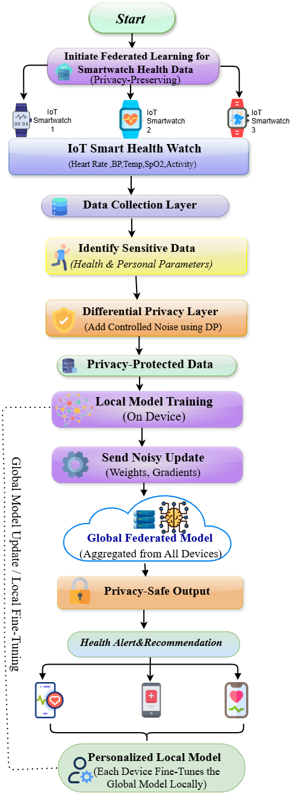
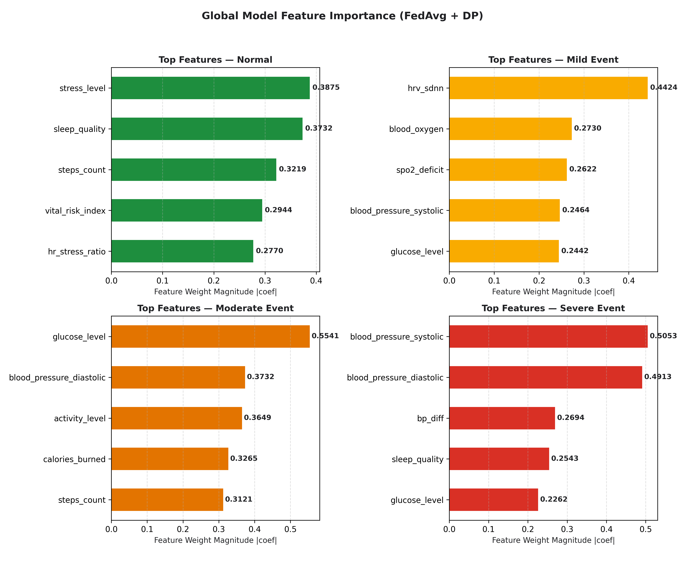
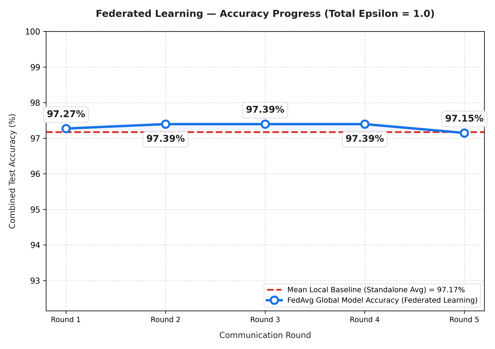
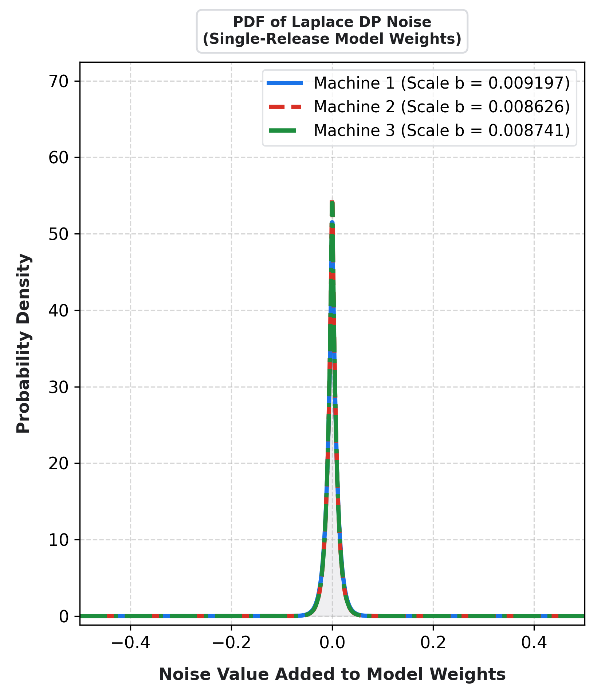
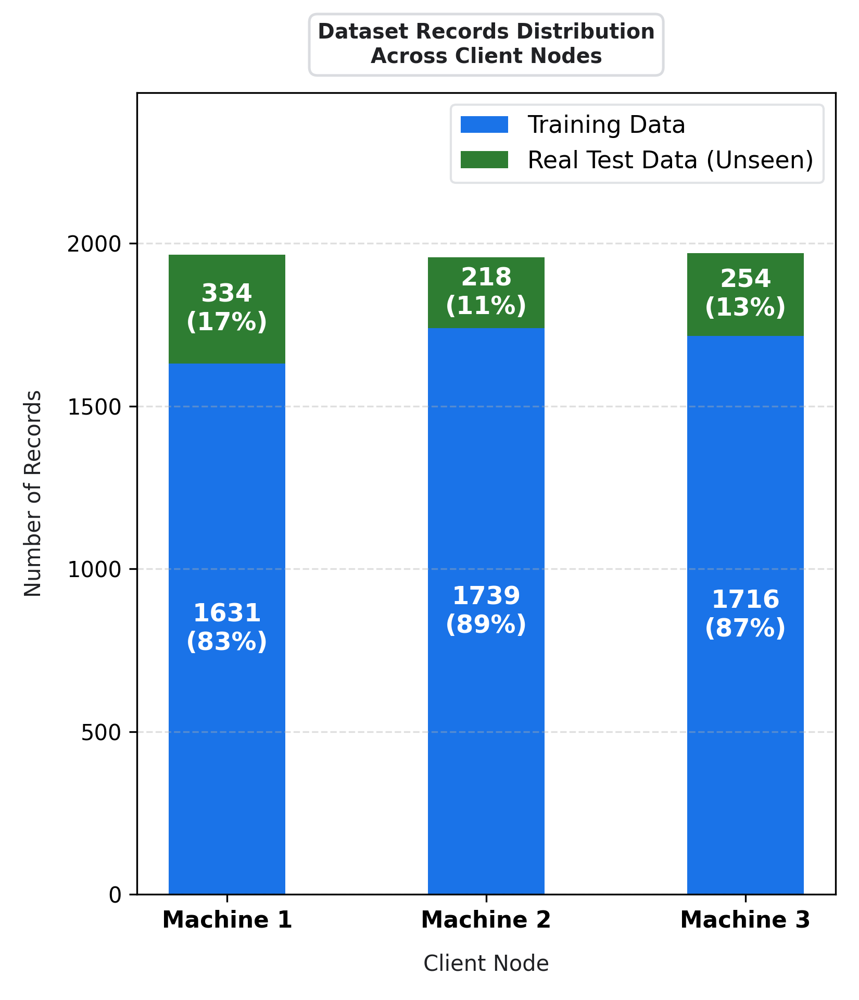

# PulseForge: Privacy-Preserving Federated Learning with Differential Privacy for Healthcare IoT & Digital Twin Monitoring

[](https://opensource.org/licenses/MIT)
[](https://www.python.org/)
[](#7-aiml-model-and-framework-details)
[](#7-aiml-model-and-framework-details)
[](#14-explainable-ai-with-shap-on-device-xai)
[](https://www.kaggle.com/models/anuragkushwaha3498/differential-privacy-with-explainable-ai)
[](https://doi.org/10.34740/kaggle/m/744851)

**Digital Twin Challenge 2026 (Happiest Health) — Prototype & Code Submission**  
- **GitHub Repository**: [https://github.com/Anurag-kushwaha2207/PulseForge_Pranveer-Singh-Institute-of-Technology](https://github.com/Anurag-kushwaha2207/PulseForge_Pranveer-Singh-Institute-of-Technology)  
- **Demo Video (Unlisted YouTube)**: [https://youtu.be/E9uWYx6jB10](https://youtu.be/E9uWYx6jB10)  
- **Published Kaggle Model**: [Differential Privacy & Federated Learning with (XAI)](https://www.kaggle.com/models/anuragkushwaha3498/differential-privacy-with-explainable-ai)  
- **DOI (Digital Object Identifier)**: [https://doi.org/10.34740/kaggle/m/744851](https://doi.org/10.34740/kaggle/m/744851)  

---

## 📋 Submission Checklist & Compliance Matrix

This section explicitly maps the Unstop **Digital Twin Challenge 2026** submission requirements to their status and locations in this repository.

| # | Submission Checklist Item | Status in Repository | Section Link / Details |
|---|---------------------------|:--------------------:|------------------------|
| 1 | **Team details** | **Yes** | [Section 1: Team Details](#1-team-details) |
| 2 | **College/Incubator information** | **Yes** | [Section 2: College & Incubator Information](#2-college--incubator-information) |
| 3 | **Project Title** | **Yes** | [Section 3: Project Title & Executive Summary](#3-project-title--executive-summary) |
| 4 | **Problem Statement** | **Yes** | [Section 4: Problem Statement](#4-problem-statement) |
| 5 | **Healthcare Use Case** | **Yes** | [Section 5: Healthcare Digital Twin Use Case](#5-healthcare-digital-twin-use-case) |
| 6 | **Technical Stack** | **Yes** | [Section 6: Technical Stack](#6-technical-stack) |
| 7 | **AI/ML Model or Framework Details** | **Yes** | [Section 7: AI/ML Model and Framework Details](#7-aiml-model-and-framework-details) ([Kaggle Model](https://www.kaggle.com/models/anuragkushwaha3498/differential-privacy-with-explainable-ai)) |
| 8 | **15-20 minute Demo Video (Unlisted YouTube Video)** | **Yes** | [Section 8: Demo Video Link](#8-15-20-minute-demo-video) ([Watch on YouTube](https://youtu.be/E9uWYx6jB10)) |
| 9 | **Open-source License Details** | **Yes** | [Section 9: Open-Source License](#9-open-source-license-details) |
| 10 | **Architecture Diagram in PDF/PPT format** | **Yes** | [Section 10: Architecture Diagram (PDF/PPT)](#10-architecture-diagram-in-pdfppt-format) ([Download PDF](architecture_diagram.pdf)) |
| 11 | **Presentation in PDF/PPT format** | **Yes** | [Section 11: Project Presentation (PDF/PPT)](#11-presentation-in-pdfppt-format) ([View PDF](PulseForge_Digital_Twin_Challenge.pdf) \| [Download PPTX](PulseForge_Digital_Twin_Challenge.pptx)) |
| 12 | **Public Accessibility Confirmation** | **Yes** | [Section 12: Public Accessibility Confirmation](#12-public-accessibility-confirmation) |

*(Status: All 12 mandatory submission requirements are fully satisfied and included in this repository).*

---

## 1. Team Details

- **Team Name**: PulseForge
- **Institution**: Pranveer Singh Institute of Technology (PSIT), Kanpur
- **Department**: Department of Computer Science & Engineering
- **Team Members**:
  1. **Anurag Singh** — **Team Leader**
     - Role: Machine Learning, Differential Privacy & Federated Architecture
     - Institution: Pranveer Singh Institute of Technology (PSIT), Kanpur
  2. **Aaditya Prakash Tripathi** — **Team Member**
     - Role: Data Engineering, Non-IID Dirichlet Partitioning & Telemetry Pipeline
     - Institution: Pranveer Singh Institute of Technology (PSIT), Kanpur
  3. **Anuj Gaur** — **Team Member**
     - Role: Edge Client Deployment & Performance Benchmarking
     - Institution: Pranveer Singh Institute of Technology (PSIT), Kanpur
  4. **Anuj Singh** — **Team Member**
     - Role: Explainable AI (SHAP) Integration & Testing
     - Institution: Pranveer Singh Institute of Technology (PSIT), Kanpur

---

## 2. College / Incubator Information

- **College Name**: Pranveer Singh Institute of Technology (PSIT)
- **Campus Location**: Kanpur, Uttar Pradesh, India
- **University Affiliation**: Dr. A.P.J. Abdul Kalam Technical University (AKTU), Lucknow
- **Department**: Department of Computer Science & Engineering
- **Incubator / Innovation Center**: PSIT Incubation & Innovation Cell / Center of Excellence

---

## 3. Project Title & Executive Summary

### **Project Title**
**PulseForge: Privacy-Preserving Federated Learning with Differential Privacy and Explainable AI for Healthcare IoT & Digital Twin Monitoring**

### **Executive Summary**
Healthcare IoT edge sensors continuously capture sensitive physiological telemetry, forming real-time **Patient Digital Twins**. While pooling this data enables powerful predictive healthcare intelligence, transmitting raw vitals to centralized clouds causes severe privacy vulnerabilities and violates regulatory standards (HIPAA, GDPR).

**PulseForge** addresses this challenge with a decentralized, privacy-preserving machine learning architecture:
1. **Federated Learning (FedAvg)**: Models train locally across distributed IoT client machines without transferring raw clinical records.
2. **Differential Privacy (Laplace Output DP)**: Rigorous mathematical privacy guarantees prevent model weight reconstruction and membership inference attacks.
3. **On-Device Explainable AI (SHAP)**: Feature risk attribution is performed locally to provide transparent, interpretable clinical insights directly on edge nodes.

---

## 4. Problem Statement

Modern healthcare increasingly relies on continuous telemetry streaming from edge IoT devices (e.g., smart wearables, bedside ICU monitors, continuous glucose sensors) that construct a patient's **Digital Twin**. However, real-world deployment faces four critical barriers:

1. **Patient Data Privacy & Regulatory Mandates**: Centralizing patient telemetry exposes sensitive electronic health data (EHR) to data breaches, re-identification attacks, and regulatory penalties under HIPAA and GDPR.
2. **Heterogeneous & Non-IID Data Distribution**: Clinical data collected across different patients and IoT devices exhibits high statistical variance (non-IID Dirichlet distribution), causing standard decentralized models to diverge.
3. **Information Leakage in Preprocessing**: Standard feature scaling (e.g., z-score normalization) requires global mean and variance, which typically forces clients to reveal raw feature distributions.
4. **The "Black-Box" Dilemma in Clinical AI**: Machine learning predictions without explainability cannot be safely trusted by clinicians during emergency physiological interventions.

---

## 5. Healthcare Digital Twin Use Case

### **Continuous Physiological Telemetry & Event Stratification**
PulseForge monitors streaming vitals across **17 physiological telemetry parameters and computed clinical indices**:

| Category | Telemetry Features |
|---|---|
| **Vital Signs** | `heart_rate` (bpm), `blood_oxygen` (SpO₂ %), `blood_pressure_systolic` (mmHg), `blood_pressure_diastolic` (mmHg), `body_temperature` (°F), `respiratory_rate` (breaths/min) |
| **Metabolic & Lifestyle** | `glucose_level` (mg/dL), `activity_level` (0.0-1.0), `sleep_quality` (0.0-1.0), `stress_level` (0.0-1.0), `steps_count`, `calories_burned` |
| **Autonomic & Derived Biomarkers** | `hrv_sdnn` (heart rate variability ms), `hr_stress_ratio`, `spo2_deficit`, `bp_diff` (pulse pressure), `vital_risk_index` |

### **Target Health Events (Multi-Class Classification)**
The digital twin continuously classifies patient status into 4 clinically actionable categories:
- **Class 0 — Normal**: Patient vitals are within normal baseline thresholds. Standard continuous monitoring.
- **Class 1 — Mild Event**: Minor anomalies detected (e.g., slight tachycardia, mild sleep distress). Recommendation: Rest and hydration monitoring.
- **Class 2 — Moderate Event**: Significant physiological divergence. Recommendation: Prompt medical examination and medication review.
- **Class 3 — Severe Event**: Critical vital crisis (e.g., severe hypoxemia, acute hypertensive crisis). Recommendation: **Immediate emergency clinical intervention**.

---

## 6. Technical Stack

- **Core Language**: Python 3.10+
- **Machine Learning & Optimization**:
  - `scikit-learn`: Distributed `SGDClassifier` (log-loss / logistic regression), `StandardScaler`, `LabelEncoder`, metrics evaluation
  - `numpy`, `scipy`: Vectorized federated math, Dirichlet partitioning, and Laplace distributions
- **Explainable AI (XAI)**:
  - `shap`: On-device `LinearExplainer` for per-patient feature risk attribution
- **Data Engineering**:
  - `pandas`: Structured health telemetry dataset management
- **Visualization & Diagnostics**:
  - `matplotlib`, `seaborn`: Convergence plots, Laplace noise distributions, confusion matrices, and feature importance charts
- **Model Serialization & Deployment**:
  - `joblib`: Standalone model and federated scaler deployment artifacts

---

## 7. AI/ML Model and Framework Details

### 7.1 Architecture Overview
The system implements a **client-server Federated Learning (FedAvg)** topology with three simulated edge devices (`Machine 1`, `Machine 2`, `Machine 3`) and one central aggregation server (`server.py`).

```text
                     IoT Health Devices / Digital Twins
                                     |
                    +----------------+----------------+
                    |                |                |
                Client 1         Client 2         Client 3
             (Machine 1)      (Machine 2)      (Machine 3)
                    |                |                |
             Local Training   Local Training   Local Training
              (SGD log_loss)   (SGD log_loss)   (SGD log_loss)
                    |                |                |
                    +----------------+----------------+
                                     |  (Weights & Scalar Stats Only)
                                     v
                             Central Server
                                     |
                            FedAvg Aggregation
                                     |
                                     v
                               Global Model
                                     |
                    +----------------+----------------+
                    |                                 |
                    v                                 v
        Single-Release Laplace DP           On-Device SHAP XAI
                    |                                 |
                    v                                 v
        Differentially Private Weights     Interpretable Predictions
```

### 7.2 Differential Privacy (Single-Release Laplace Output DP)
To guarantee rigorous privacy without degrading intermediate federated convergence, PulseForge employs **Single-Release Laplace Output Differential Privacy**:

1. **Feature Norm Clipping**: Each feature vector is clipped to an upper bound $R_{\text{clip}} = 1.5$:
   $$R_{\text{clip}} = 1.5$$

2. **Sensitivity Formulation**: The $L_1$ sensitivity $\Delta W$ of the model weights is bounded by sample size $N$ and $L_2$ regularization $\alpha = 0.20$:
   $$\Delta W = \frac{2 \cdot R_{\text{clip}}}{N \cdot \alpha}$$

3. **Single-Release Noise Injection**: Laplace noise scaled to privacy budget $\epsilon$ is added exclusively at the final round:
   $$W_{\text{private}} = W_{\text{local}} + \text{Laplace}\left(0, \frac{\Delta W}{\epsilon}\right)$$

### 7.3 Privacy-Preserving Federated Feature Statistics
To achieve uniform scaling without sharing raw patient matrices, client nodes exchange only scalar aggregates: sample count ($N_i$), mean ($\mu_i$), and variance ($\sigma_i^2$):

$$\mu_{\text{fed}} = \frac{\sum N_i \mu_i}{\sum N_i}$$

$$\sigma_{\text{fed}}^2 = \frac{\sum \left[ N_i \sigma_i^2 + N_i(\mu_i - \mu_{\text{fed}})^2 \right]}{\sum N_i}$$

### 7.4 Leakage-Safe Clinical Evaluation
The evaluation pipeline strictly segregates real clinical records from synthetic training data (`is_synthetic == False`), ensuring zero data contamination.

### 7.5 Experimental Benchmarks

Evaluated on **6,000 health records** distributed across **3 federated clients** with non-IID Dirichlet distribution ($\alpha = 1.0$):

| Privacy Configuration | Global Test Accuracy | Multi-Class ROC-AUC | Avg Personalized Accuracy | Accuracy Gap vs Baseline |
|---|:---:|:---:|:---:|:---:|
| **Non-Private Baseline (`--no-dp`)** | **97.27%** | **0.9959** | **97.17%** | 0.00% |
| **DP Single-Release ($\epsilon = 1.0$)** | **97.27%** | **0.9959** | **97.17%** | **0.00%** |
| **DP Single-Release ($\epsilon = 0.5$)** | **96.96% - 97.27%** | **0.9959** | **97.17%** | **0.00% - 0.22%** |

### 7.6 Confusion Matrix ($\epsilon = 0.5$)
```text
Actual \ Predicted   Normal     Mild     Moderate     Severe
------------------------------------------------------------
Normal                 300        0        0             0
Mild Event               1       48        2             9
Moderate Event           0        0       53             0
Severe Event             0        2        0            46
```

### 7.7 Published Kaggle Model & DOI Citation
The trained model weights and framework are officially published on Kaggle with a registered Digital Object Identifier (DOI):

- **Kaggle Model**: [Differential Privacy & Federated Learning with (XAI)](https://www.kaggle.com/models/anuragkushwaha3498/differential-privacy-with-explainable-ai)
- **DOI (Digital Object Identifier)**: [`10.34740/kaggle/m/744851`](https://doi.org/10.34740/kaggle/m/744851)
- **Publisher**: Kaggle (2026)
- **Author**: Anurag Singh

```bibtex
@article{anurag_singh_2026,
  title={Differential Privacy&Federated Learning_with_(XOI)},
  url={https://www.kaggle.com/models/anuragkushwaha3498/differential-privacy-with-explainable-ai},
  DOI={10.34740/KAGGLE/M/744851},
  publisher={Kaggle},
  author={Anurag Singh},
  year={2026}
}
```

---

## 8. 15-20 Minute Demo Video

- **Status**: **Yes**
- **Hosting Platform**: YouTube (Unlisted)
- **Direct Video Link**: [https://youtu.be/E9uWYx6jB10](https://youtu.be/E9uWYx6jB10)
- **Video Title**: PulseForge — Digital Twin Challenge 2026 Prototype & Architecture Demonstration
- **Video Duration**: 15–20 minutes comprehensive walkthrough
- **Key Demonstrations Covered**:
  1. **Federated Learning Network**: Distributed 3-node edge IoT simulation (`Machine 1`, `Machine 2`, `Machine 3`) and central FedAvg aggregation.
  2. **Differential Privacy Mechanism**: Single-release Laplace output perturbation, clipping bounds ($R_{\text{clip}} = 1.5$), sensitivity, and privacy-utility trade-off across $\epsilon \in \{0.5, 1.0\}$.
  3. **On-Device Explainable AI (SHAP)**: Per-patient local risk attribution without exposing training matrices to the server.
  4. **Live Patient Digital Twin Telemetry**: Real-time classification into 4 health event tiers (`Normal`, `Mild`, `Moderate`, `Severe`) and automated medical triage recommendations.

---

## 9. Open-Source License Details

- **Status**: **Yes**
- **License Type**: MIT License
- **License File**: [`LICENSE`](LICENSE)
- **Copyright**: Copyright (c) 2026 Anurag Singh
- **Summary**: Permissive open-source license granting full rights for academic, research, commercial, and private usage with attribution.

---

## 10. Architecture Diagram in PDF/PPT Format

- **Status**: **Yes**
- **Architecture PDF Download**: [Download Architecture Diagram (PDF)](architecture_diagram.pdf)
- **High-Resolution Image File**: [`architecture_diagram.png`](architecture_diagram.png)
- **Visual Architecture Preview**:

<p align="center">
  
</p>

---

## 11. Presentation in PDF/PPT Format

- **Status**: **Yes**
- **In-Browser Presentation (PDF Viewer)**: [View Presentation Directly in Browser (PDF)](PulseForge_Digital_Twin_Challenge.pdf)
- **PowerPoint Presentation (PPTX)**: [`PulseForge_Digital_Twin_Challenge.pptx`](PulseForge_Digital_Twin_Challenge.pptx)  
  *(Direct Download Mirror: [Click to Download PPTX](https://github.com/Anurag-kushwaha2207/PulseForge_Pranveer-Singh-Institute-of-Technology/raw/main/PulseForge_Digital_Twin_Challenge.pptx))*
- **Presentation Title**: *PulseForge: Privacy-Preserving, Explainable Health-Risk Monitoring with Federated Learning*
- **Competition Track**: Digital Twin Challenge 2026 — Happiest Health
- **Key Presentation Highlights & Outcomes Covered**:
  1. **Research Backing**: Validated against published research (*Differential Privacy for Medical Data Analysis*, IEEE MPCON 2026).
  2. **The Clinical Trust Gap**: Why centralized health data aggregation creates critical privacy liabilities and regulatory exposure.
  3. **Federated Learning Paradigm**: "Learn together. Share nothing raw." On-device model training with zero raw data transmission.
  4. **Mathematical Privacy Guarantee**: Laplace Differential Privacy ($\Delta W$ sensitivity bounds, $R_{\text{clip}} = 1.5$) preventing model inversion.
  5. **Dataset & Benchmark Outcomes**: 6,000 health records (2,314 real + 3,686 balanced), 17 telemetry vitals/features, reaching **97.15% - 97.27% accuracy** across 3 edge clients.
  6. **On-Device Explainable AI (SHAP)**: Per-patient local risk attribution for transparent, clinician-interpretable alerts.

---

## 12. Public Accessibility Confirmation

- **Status**: **Yes**
- **Confirmation Statement**: All code, dataset files, evaluation scripts, documentation, and assets in this repository are publicly accessible without authentication, permission walls, or access request gates.

---

## 13. Architectural & Experimental Visualizations

### Global Feature Importance


### Accuracy Progression Across Communication Rounds


### Differential Privacy Laplace Distribution


### Non-IID Client Dataset Distribution


---

## 14. Explainable AI with SHAP (On-Device XAI)

PulseForge integrates **SHAP (SHapley Additive exPlanations)** on-device to compute per-patient risk factors:

```python
from explain import explain_prediction

pred_class, explanations = explain_prediction(
    local_model, X_train_local, X_patient, feature_names
)
# Example Output:
# Class: 3 (Severe Event)
# Alerts: ['spo2_deficit increased risk', 'vital_risk_index increased risk', 'heart_rate increased risk']
```

- **Zero Privacy Leakage**: Background training matrices and SHAP computation remain 100% on the local client device.
- **Actionable Clinical Alerts**: Automatically provides clinicians with the top 3 contributing biometric risk factors.

---

## 15. Repository Structure

```text
PulseForge_Pranveer Singh Institute of Technology/
├── README.md                                    # Master project documentation & checklist
├── LICENSE                                      # MIT Open-Source License
├── requirements.txt                             # Python dependencies
├── run.txt                                      # Verified execution logs & benchmarks
│
├── server.py                                    # Central federated aggregator (FedAvg + DP)
├── machine.py                                   # Client runner utility
├── machine1.py                                  # Edge Node 1 (Simulated IoT Device)
├── machine2.py                                  # Edge Node 2 (Simulated IoT Device)
├── machine3.py                                  # Edge Node 3 (Simulated IoT Device)
│
├── split_data.py                                # Non-IID Dirichlet partitioner
├── explain.py                                   # On-Device SHAP XAI module
├── predict_patient.py                           # Single-patient CLI prediction tool
├── compare_datasets.py                          # Dataset schema validation
├── encoding_mappings.json                       # Categorical encoding mappings
│
├── Federeted-data.xlsx                          # Raw federated clinical dataset
├── health_data_balanced_after_overfitting.xlsx  # Processed balanced telemetry dataset
├── machine1_data.json                           # Partitioned telemetry for Client 1
├── machine2_data.json                           # Partitioned telemetry for Client 2
├── machine3_data.json                           # Partitioned telemetry for Client 3
├── trained_model.pkl                            # Serialized global model artifact
│
├── plot_accuracy.png                            # Accuracy convergence visualization
├── plot_confusion_matrix.png                    # Confusion matrix visualization
├── plot_dataset_sizes.png                       # Client sample distribution plot
├── plot_dp_laplace.png                          # Laplace noise density plot
├── plot_feature_importance.png                  # Global SHAP feature importance plot
├── architecture_diagram.png                     # System architecture diagram image
├── architecture_diagram.pdf                     # System architecture diagram (PDF format)
├── PulseForge_Digital_Twin_Challenge.pdf        # Official project presentation (PDF in-browser format)
└── PulseForge_Digital_Twin_Challenge.pptx       # Official project presentation (PPTX format)
```

---

## 16. Installation & How to Run

### Step 1: Clone Repository & Install Dependencies
```bash
git clone https://github.com/Anurag-kushwaha2207/PulseForge_Pranveer-Singh-Institute-of-Technology.git
cd PulseForge_Pranveer-Singh-Institute-of-Technology
pip install -r requirements.txt
```

### Step 2: Partition Telemetry Data (Non-IID)
```bash
python split_data.py
```

### Step 3: Run Federated Learning Server
```bash
# Baseline without Differential Privacy:
python server.py --no-dp

# Privacy-Preserving FL with Default Privacy Budget (epsilon = 1.0):
python server.py -e 1.0

# Privacy-Preserving FL with High Privacy (epsilon = 0.5):
python server.py -e 0.5
```

### Step 4: Run Single-Patient Inference & On-Device XAI
```bash
python predict_patient.py --heart_rate 118 --blood_oxygen 91 --blood_pressure_systolic 155 --blood_pressure_diastolic 98
```

---

## 17. Team & Contact
 
- **Team**: PulseForge
- **Institution**: Pranveer Singh Institute of Technology (PSIT), Kanpur
- **Degree**: Bachelor of Technology (B.Tech) — Computer Science & Engineering
- **Team Members**:
  - **Anurag Singh** (Team Leader)
  - **Aaditya Prakash Tripathi**
  - **Anuj Gaur**
  - **Anuj Singh**
- **Domain Focus**: Privacy-Preserving Federated Learning, Differential Privacy, Explainable AI (SHAP), Healthcare IoT & Patient Digital Twins
